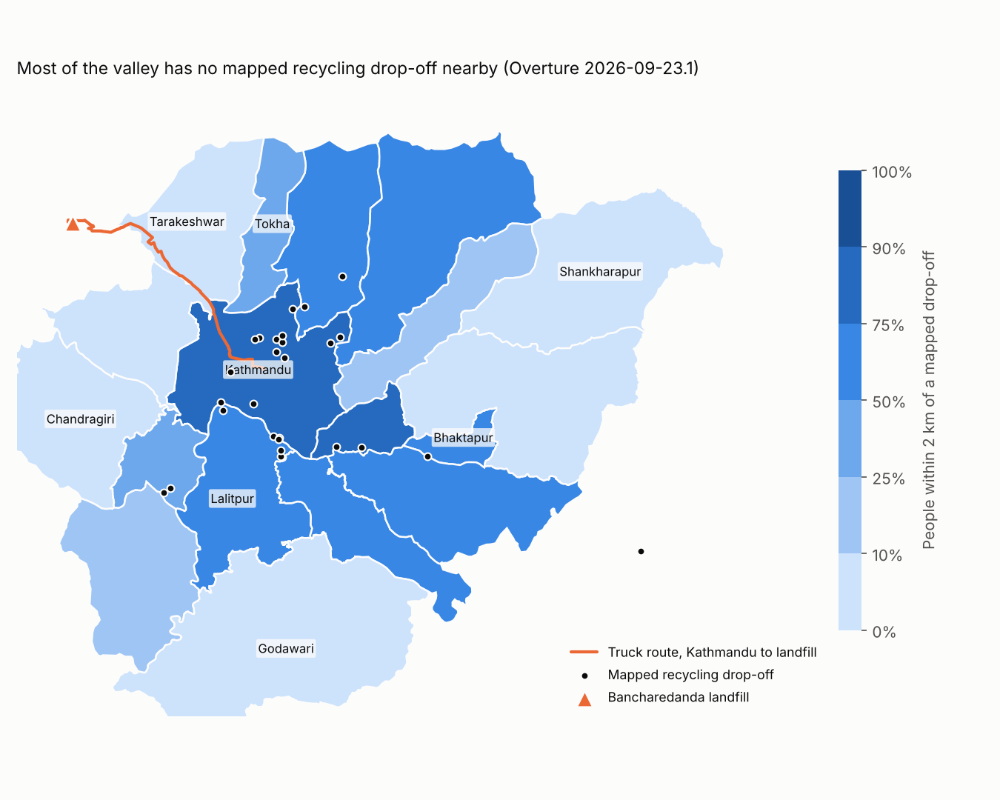
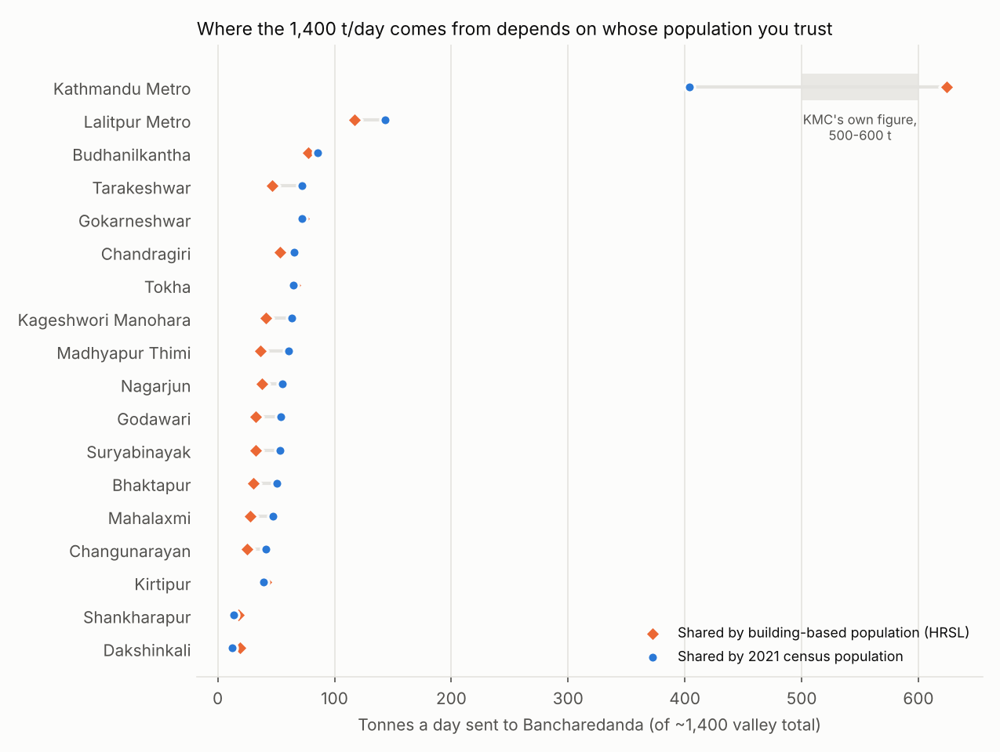
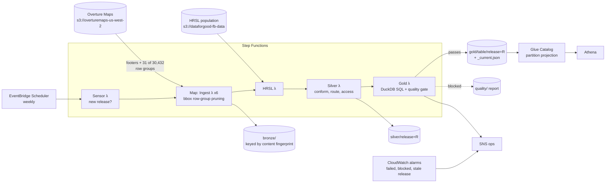

# Fohor (फोहोर): where the Kathmandu Valley's waste goes, and what happens when it can't

[](https://fohor-kathmandu-waste.onrender.com)

Every day about **1,400 tonnes** of waste from the Kathmandu Valley is trucked over the hills to one landfill, Bancharedanda, on the Nuwakot/Dhading border. It opened in May 2022 with a 20-year design life and was described as overwhelmed after four. When the people who live beside it block the road, and they have, repeatedly, garbage piles up on Kathmandu's streets within days.

Fohor is a data pipeline that answers the questions a ward office or a newsroom asks on day one of a blockade: **how much will pile up, where first, and how long will it take to clear?** It also maps the other half of the problem, how few recycling drop-offs the valley's open map knows about. It builds a small lakehouse on AWS from open data (Overture Maps and Meta's population layer on the AWS Open Data registry, the 2021 census, and published landfill figures), reads **0.18% of the 119 GB** it draws on, refuses to publish a release that fails its quality gate, and costs about **$1.14 a month**.

```text
$ python -m fohor blockade --days 7

Fohor blockade report: Bancharedanda closed for 7 days (map data 2026-09-23.1)

  9,800 t of waste uncollected across the valley, about 1,400 truckloads;
  5,292 t of it food and other organic waste that starts to rot within days.
  Clearing it takes ~23 days after the road opens if trucks can do 130% of normal trips
  (14 days at 150%, 35 at 120%).

  Largest piles:
    Kathmandu Metropolitan City      2,827 t    404 truckloads
    Lalitpur Metropolitan City       1,002 t    144 truckloads
    Budhanilkantha                     601 t     86 truckloads
    Tarakeshwar                        507 t     73 truckloads
    Gokarneshwar                       505 t     73 truckloads
  Longest haul once open: Shankharapur, ~37 km each way, 4.1 h per round trip.

  फोहोर प्रतिवेदन: बन्चरेडाँडा ७ दिन बन्द हुँदा उपत्यकामा ९,८०० टन फोहोर (करिब १,४०० ट्रक) थुप्रिन्छ, जसमध्ये ५,२९२ टन कुहिने फोहोर हो।
  बाटो खुलेपछि सफा गर्न करिब २३ दिन लाग्छ।
```
*(Real output from the September 2026 Overture release. The clearing times depend on an assumed fleet surge, so the report prints three.)*

## The problem

The valley's 18 local governments send their waste to one place, over one road. Everything about that system is fragile, and almost none of it is published as data. What exists is scattered and contradicts itself:

- **The tonnage is a number in a newspaper.** ~1,400 t/day and ~200 trucks (OnlineKhabar, August 2026). Nobody publishes it per municipality.
- **Population depends on whom you ask.** Meta's building-based population layer puts 1.67 million people in Kathmandu Metropolitan City; the 2021 census says 845,767. Even the census disagrees with itself: Kathmandu district's municipalities sum to 2.7% less than the district total.
- **The open map's names and ids move under you.** Mahalaxmi Municipality carries Lalitpur Metropolitan City's Nepali name. Between two releases two days apart, every OpenStreetMap-derived waste point in the valley got a new id.
- **"Recycling" is whatever someone tagged.** A sand works, a vehicle workshop and a house are tagged as recycling points; real recyclers are filed as a tour operator and a mattress maker.

Fohor is the data engineering that makes these sources usable together: it extracts only what it needs, keys everything on identities that survive a release, reconciles the population sources openly, and won't publish numbers it can't stand behind.

## What it finds

| | |
|---|---|
| Valley population (18 local governments) | 2,931,735: census where sourced (12), district residual by building-based share (6) |
| Reported landfill intake | 1,400 t/day → 0.478 kg/person/day, 1.5x ADB's 2013 national average |
| Kathmandu Metropolitan City's share | **404 t/day** by census population, **624 t/day** by building-based population; KMC's own figures are 500-600 |
| Truck haul | 13.6 km (Tarakeshwar) to 36.7 km (Shankharapur) each way; **~8,900 truck-km a day** valley-wide |
| One week of blockade | **9,800 t** and 1,400 truckloads; ~23 days to clear at 130% fleet capacity |
| Mapped recycling drop-offs | 27 after review (23 from OSM, 4 from Meta places); 26 inside the 18 local governments, for 2.9 million people |
| People more than 2 km from any mapped drop-off | **1.39 million (47%)**; 12 of 18 local governments have none mapped |



The map measures the open map as much as the city: there are certainly kabadi shops in Tarakeshwar. But anything built on open data, a "nearest recycler" app or a city dashboard, inherits exactly this gap, and Fohor's `data_gaps` table says where it is.



The two dots are the same 1,400 t/day shared two ways. The census counts residents; the core's waste also comes from shops, offices and commuters. Both are published, and [docs/DATA.md](docs/DATA.md) explains why neither is the truth.

## Architecture



| Layer | Choice | Why, in one line |
|---|---|---|
| Ingest | Lambda per theme, footers read in parallel, row groups pruned on `bbox` statistics, only needed columns | 214.5 MB of 119.1 GB read; 7.6 s for the largest theme |
| Bronze | S3, keyed by a fingerprint of the theme's file ETags | A patch release with unchanged themes reads nothing; Overture deletes old releases, so bronze is our copy |
| Silver | pyarrow + shapely + networkx in Lambda | Local governments pinned by id, population reconciled, facilities conflated, road graph routed |
| Gold | DuckDB SQL in Lambda, one partition per release | Same SQL on a laptop, in tests and in AWS |
| Quality | Issues raised next to the code they protect, gate with block/warn | A bad release leaves last month's numbers in place and pages someone |
| Catalog | Glue tables in CloudFormation, partition projection on `release` | No crawler, no `MSCK REPAIR` |
| Orchestration | Step Functions + EventBridge Scheduler (weekly sensor) | Retries per step, a Map state for themes, a few cents a month |
| Region | us-west-2 | Next to Overture: no cross-region transfer for us or for the public bucket's sponsors |

The decision records (why extract instead of querying Overture in place, why identity is the upstream record and not the GERS id, why census totals and HRSL pattern) are in [docs/ARCHITECTURE.md](docs/ARCHITECTURE.md).

## Alternatives, failure modes and cost

- **[docs/ALTERNATIVES.md](docs/ALTERNATIVES.md)**: Athena over Overture in place, Geofabrik/osmium, Glue Spark + Sedona, DuckDB spatial, PostGIS, Amazon Location Service, OSRM, MWAA, Iceberg, QuickSight, and when I'd switch to each.
- **[docs/FAILURE_MODES.md](docs/FAILURE_MODES.md)**: re-keyed ids, wrong names, missing themes, a collapsing facility count, a split road graph, a dead sensor, parallel writers, each with the test that proves the behaviour.
- **[docs/COST.md](docs/COST.md)**: about $1.14 a month, 90% of it CloudWatch. MWAA alone would be ~$358.

## Challenges and bugs

The full log is [docs/CHALLENGES_AND_BUGS.md](docs/CHALLENGES_AND_BUGS.md). The ones I learned most from:

1. **50 recycling points "closed" and 50 "opened" overnight.** Overture's patch release re-keyed every OSM-derived feature in the valley. Facilities are now identified by their OpenStreetMap or Meta record id, and the change log says `rekeyed`.
2. **Mahalaxmi is called Lalitpur.** Never join on names in open data. The 18 local governments are pinned by id; the source name is compared and a mismatch warns on every run.
3. **Meta's population layer doubles Kathmandu.** Use each source for what it's good at: census for totals, buildings for where people live inside a municipality.
4. **Momo shops and fireflies in the recycling registry.** Substring matching on "dump" and "junk" found every Dumpling restaurant and every business called Junkiri. Word-boundary patterns, category first, and the evidence recorded on each row.
5. **Every truck route was unreachable.** The road nearest the landfill is an internal service road in a two-node island. Snap only to the main connected component.

## Try it live

**[https://fohor-kathmandu-waste.onrender.com](https://fohor-kathmandu-waste.onrender.com)**

Slide the number of days the landfill road is blocked and read the blockade report, see where the waste comes from, how far people live from a recycling drop-off, and run SQL over the gold tables.

It runs on a free server that sleeps when nobody is using it, so the first visit can take a minute to wake up. Everything runs offline: no API keys, no cloud account.

To run the same page locally: `pip install -r requirements-app.txt` and then `streamlit run app.py`.

## Run it

Needs Python 3.12+. No AWS account needed: both source buckets allow anonymous reads.

```bash
make setup && source .venv/bin/activate
make run              # latest Overture release + HRSL -> lake/ (about a minute, ~200 MB read)
make blockade         # the 7-day report
python -m fohor blockade --days 3
python -m fohor query "select name_en, tonnes_per_day, haul_km_mean, truck_km_per_day from municipality_waste"
python -m fohor query "select * from facility_registry where review <> 'auto'"
make test             # 23 tests on a synthetic release, no network
```

Deploying to AWS: [infra/README.md](infra/README.md). Example Athena queries: [sql/athena/](sql/athena/).

## Repository layout

```text
fohor/
  config.py        bbox, themes, pinned ids, and every published figure with its source
  source.py        Overture/HRSL listing, fingerprints, row-group-pruned extraction
  ingest.py        bronze: content-keyed extracts, one manifest entry per (release, theme)
  silver.py        local governments, population reconciliation, facilities, road edges
  analysis.py      haul distances (Dijkstra) and drop-off access (KD-tree)
  sql/             gold models (DuckDB SQL), run in order
  gold.py          builds gold, facility history and release-to-release changes
  quality.py       gold checks and the publish decision
  report.py        the blockade report, English and Nepali
  pipeline.py      the stages wired together
  aws/handlers.py  Lambda entry points for Step Functions
seeds/             census figures and reviewed facility overrides, with sources and reasons
infra/             SAM template (S3, Lambda, Step Functions, Glue, Athena, SNS, alarms, budget)
sql/athena/        analyst queries
scripts/           charts, cost model
tests/             23 tests, including the Lambdas against mocked S3 and SNS
docs/              data, architecture, alternatives, failure modes, cost, bugs
```

## Honest limits

- **The tonnage is reported, not measured.** 1,400 t/day comes from one news report of what reaches the landfill, and it includes three local governments outside the valley. Everything per-municipality is an allocation of that number.
- **Mapped is not existing.** The access tables show what OpenStreetMap and Overture know about recycling drop-offs, which is far less than what exists.
- **Haul distances start where people live,** not at the transfer stations where trucks actually load. Good for comparing municipalities and for totals; not a route plan.
- **Six of 18 population figures are estimates** (district census residual shared by HRSL), labelled as such in every table.
- **The AWS stack is lint-checked and its handlers are tested against mocked AWS, but I haven't deployed it to an account.** The ingest has run against the real Overture and HRSL buckets, and the full pipeline has run end to end on both September 2026 releases locally.

## Data and attribution

- © OpenStreetMap contributors, ODbL, via [Overture Maps Foundation](https://overturemaps.org) releases on the [AWS Open Data registry](https://registry.opendata.aws/overture/). Overture places data under CDLA Permissive 2.0.
- High Resolution Settlement Layer, Meta and CIESIN, CC BY 4.0, via the [AWS Open Data registry](https://registry.opendata.aws/dataforgood-fb-hrsl/).
- National Population and Housing Census 2021, National Statistics Office, Nepal (figures and links in `seeds/census_2021.csv`).
- Landfill and waste figures: OnlineKhabar English (21 Aug 2026), The Himalayan Times (9 Feb 2020), ADB (2013), CBS Waste Management Baseline Survey 2020 via The Kathmandu Post (11 May 2021). Details in [docs/DATA.md](docs/DATA.md).

Raw data is not committed; `make run` fetches it.

## License

MIT
