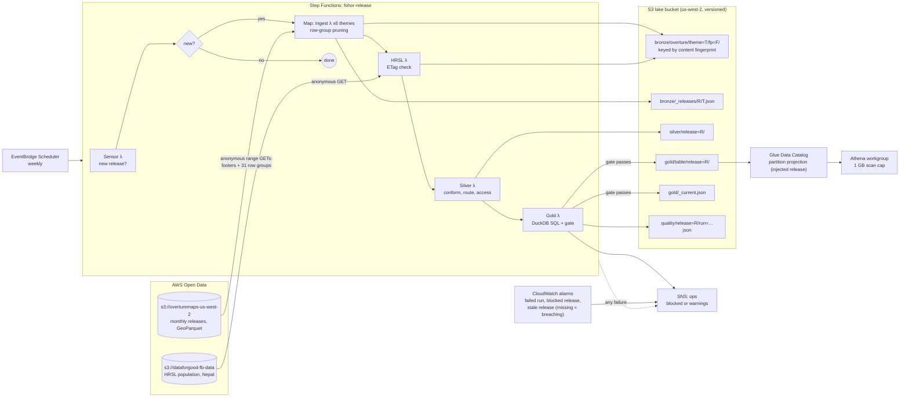

# Architecture

## The shape

## The stages

| Stage | Reads | Writes | Unit of work | Idempotent because |
|---|---|---|---|---|
| **Sensor** | `ListObjectsV2 release/` with a delimiter; `gold/_current.json` | nothing | one release | it only compares names |
| **Ingest** (x6, in parallel) | the theme's file listing (ETags), each file's footer, the row groups whose bbox stats overlap the valley, only the needed columns | `bronze/overture/theme=T/fp=F/part-0.parquet`, one manifest entry per (release, theme) | one theme | the bronze key is the content fingerprint; if it exists, nothing is read |
| **HRSL** | the file's ETag, then the 14 MB file if the ETag is new | `bronze/hrsl/etag=E/points.parquet` | the file | ETag-keyed, same as above |
| **Silver** | bronze for the release | `silver/release=R/*.parquet`, `_build.json` with the input signature and issues | one release | a full rebuild from bronze, replacing the release's files |
| **Gold** | silver for this and earlier releases | `quality/…/run=X.json` always; `gold/<table>/release=R/` and `gold/_current.json` only if the gate passes | one release | a full rebuild; a re-run with identical inputs is skipped by the input signature |

## Gold tables

| Table | Grain | What it answers |
|---|---|---|
| `municipality_waste` | local government | population (and its source), tonnes/day by two allocations, haul km (mean, p10, p90), truck trips and truck-km per day |
| `blockade_backlog` | local government (+ valley) x days 1-30 | tonnes and truckloads piling up, organic share, days to clear at 120/130/150% fleet |
| `drop_off_access` | local government | share of people within 500 m / 1 km / 2 km of a mapped drop-off, median distance, people beyond 2 km |
| `facility_registry` | facility | kind, source, review status, duplicate link, first and last release seen |
| `facility_changes` | facility x release | added / removed / re-keyed since the previous release |
| `data_gaps` | local government | mapped drop-offs, bins and collectors, people per drop-off |

## Decision records

### ADR-001: Extract a valley slice instead of querying Overture in place

Overture is designed to be queried in place (Athena, DuckDB, Spark over S3). For a one-off question that is the right tool. For a product it isn't, for three reasons:

1. **Releases disappear.** Overture keeps a few months of releases. If gold for September has to be rebuilt in March, the source is gone. Bronze is our copy, ~60 MB per distinct release.
2. **Every query would pay for the world.** Even with predicate pushdown, a query engine reads every file footer (30,432 row groups across 249 files for our six themes) on every query. We pay that once per release.
3. **Schema drift is caught once, at the boundary.** Places has replaced its `categories` column with `taxonomy` and `basic_category` (the release read here has no `categories` at all); reading bronze means a rename breaks one ingest run, with a clear error, not every dashboard.

Cost of the choice: 214.5 MB read per release, ~7 s per theme in parallel. See [COST.md](COST.md).

### ADR-002: Prune row groups by bbox statistics ourselves

pyarrow's dataset filter can push predicates into nested `bbox.xmin` statistics, but whether it does depends on the version, and it doesn't report what it skipped. The ingest reads each footer, keeps row groups whose `bbox` min/max overlap ours (treating missing statistics as "maybe"), and records row groups and bytes read vs total. That number is the cost story, the regression test, and the alarm input if Overture ever stops sorting spatially.

### ADR-003: Bronze keyed by content, not by release name

`2026-09-23.1` was a patch release. Its `places` files have the same names, sizes and ETags as `2026-09-23.0`; its `base` files are different. Keying bronze on a fingerprint of (file name, ETag) for each theme means the patch cost two theme extractions instead of six, and a re-run of anything costs nothing. The manifest maps release → theme → fingerprint.

### ADR-004: One manifest file per (release, theme)

The six ingest Lambdas run at once. A single manifest JSON, read-modified-written by each, loses updates: the last writer wins and silver later fails with "themes not ingested". S3 conditional writes could fix it, but there's no need for shared state at all: each Lambda writes its own small entry and `load_manifest` lists the prefix. See bug #6.

### ADR-005: Identity is the upstream record, not the GERS id

GERS ids are Overture's stable identifiers, and for divisions they held. For OSM-derived base features in the valley, all of them changed between `2026-09-23.0` and `.1`. The registry keys facilities on `osm:<type><id>` (or `meta:<id>`) with the version suffix stripped, and records the GERS id as an attribute. Local governments are pinned by GERS id with a name fallback that warns. See bug #1.

### ADR-006: Totals from the census, pattern from HRSL

No single source is right. HRSL knows where buildings are, the census knows how many people live in each municipality, and the census has gaps in what we could source. Population is census where sourced, district residual by HRSL share otherwise, and point weights are rescaled so they add up to the chosen totals. The column `population_source` records which. See [DATA.md](DATA.md).

### ADR-007: Region us-west-2

The Overture bucket is in us-west-2 and is 99% of the bytes read. Reading it from Lambda in the same region is free for us and for Overture's sponsors, who pay egress from a public bucket. The HRSL file is in us-east-1, 14 MB, and changes once in years (it hasn't since 2019); one cross-region GET per year is nothing. Users are in Nepal but only read Athena results and emails; ap-south-1 (Mumbai) would make every ingest cross-region instead.

### ADR-008: Routing with networkx on the extracted graph

Haul distance needs one shortest-path tree from the landfill gate to 76,700 road nodes, then a lookup for 111,000 population points. A single-source Dijkstra over 88,000 edges takes under a second. Amazon Location Service route matrices would cost per route and use a commercial road network we could not inspect or fix; OSRM/Valhalla on EC2 would add an always-on server for a monthly job. See [ALTERNATIVES.md](ALTERNATIVES.md).

### ADR-009: Gate before publish; `_current.json` is the only pointer readers follow

Gold for a blocked release is never written. The quality report is written either way. Readers (the CLI, the report, an Athena view if you add one) follow `gold/_current.json`, so a bad release leaves last month's numbers in place and pages someone, rather than showing a valley with no recycling points.

## Security

- Upstream reads are unsigned: no credentials are used, and no role grants access to anything but the lake bucket.
- The lake bucket blocks public access, is encrypted (SSE-S3) and versioned.
- No personal data: HRSL is aggregated to 30 m cells, facilities are businesses and public bins.
- The Athena workgroup enforces its result location and a 1 GB per-query scan cap.
